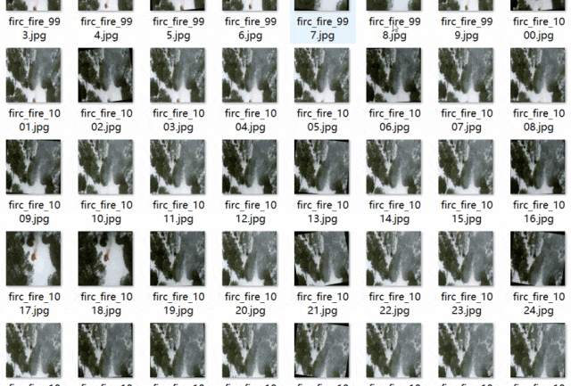
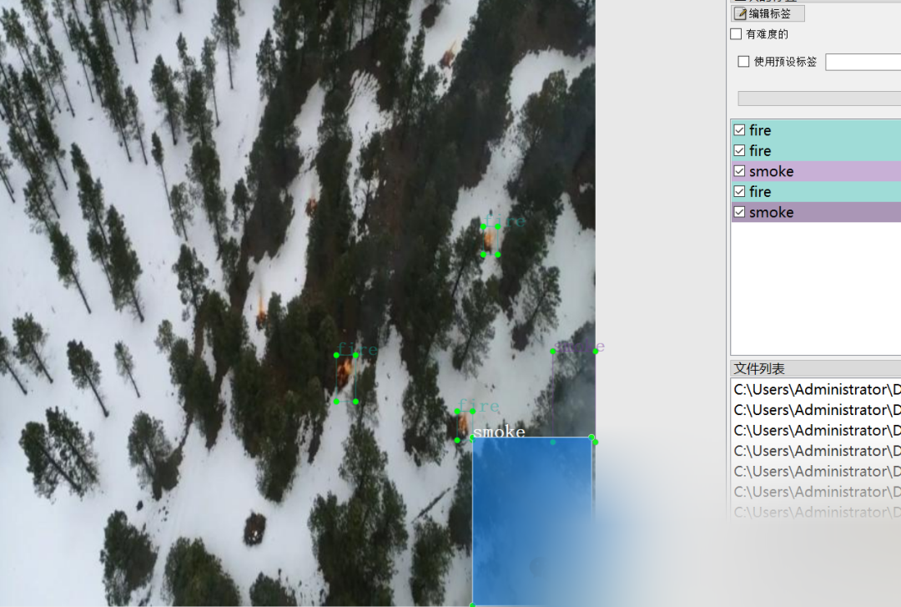

# Aerial Observation Forest Fire Detection Dataset VOC+YOLO format with 6116 images in 2 categories

Dataset format: Pascal VOC format + YOLO format (txt file without split path, only containing jpg images and corresponding VOC format xml files and yolo format txt files)
Number of images (number of jpg files): 6116
Number of annotations (number of xml files): 6116
Number of annotations (number of txt files): 6116
Number of annotation categories: 2
Annotation category names: ["fire", "smoke"]
Number of boxes per category:
fire boxes = 15380
smoke boxes = 12613
Total boxes: 27993
Labeling tool used: labelImg
Annotation rules: draw a box around the category
Important note: No guarantee is made regarding the accuracy or weights of the trained model. The dataset provides accurate and reasonable annotations only.

Image Preview:

Annotation example:

## Payment

Here is a pay link on Stripe ( https://buy.stripe.com/3cs8yP7sY87d0vu9AB ). Please contact me lonlonago@foxmail.com after funding $89, and I will send you a complete data files , thank you!

